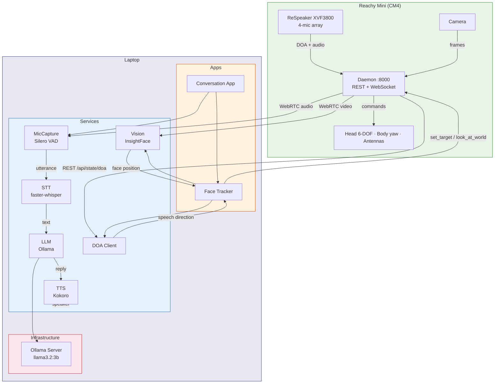

# reachy-mini

Experiments and applications for the [Reachy Mini wireless](https://www.pollen-robotics.com/reachy-mini/) desktop robot.

See [CLAUDE.md](CLAUDE.md) for repo layout, setup commands, and conventions.

## Architecture



## Apps

### Conversation (`apps/conversation/`)

Full voice conversation loop that runs concurrently with face tracking. Reachy listens via its onboard mic array, understands speech, generates a response, and speaks it back — all while looking at whoever is talking.

**Pipeline:** Robot mic → Silero VAD → faster-whisper STT → Ollama LLM → Kokoro TTS

```bash
uv run python -m apps.conversation.main

# or with the simulator
CONV_SIM=true uv run python -m apps.conversation.main
```

Configuration via environment variables (prefix `CONV_`):

| Variable | Default | Purpose |
|---|---|---|
| `CONV_LLM_MODEL` | `llama3.2:3b` | Ollama model for chat |
| `CONV_STT_MODEL` | `large-v3-turbo` | Whisper model size |
| `CONV_TTS_VOICE` | `af_heart` | Kokoro voice |
| `CONV_PERSONALITY` | `friendly` | Personality from `config/personalities.yaml` |
| `CONV_VAD_THRESHOLD` | `0.5` | Silero VAD speech probability threshold |
| `CONV_VAD_SILENCE_MS` | `1200` | Silence duration to end an utterance |

**Personalities:** `friendly`, `curious`, `professional`, `playful` — defined in `config/personalities.yaml`, swappable at runtime.

### Face Tracker (`apps/face_tracker/`)

Real-time face tracking with InsightFace detection, Kalman smoothing, DOA-based orientation, and 3-phase loss recovery. Also available via the dashboard.

### Gesture Demo (`apps/gesture_demo/`)

Scripted motion sequences using `goto_target()`.

## Services

| Service | Module | Description |
|---|---|---|
| **MicCapture** | `services/audio/mic.py` | Captures speech from robot mic array via WebRTC, VAD-based utterance segmentation |
| **STT** | `services/audio/stt.py` | Speech-to-text via faster-whisper (large-v3-turbo, CPU) |
| **TTS** | `services/audio/tts.py` | Text-to-speech via Kokoro (24kHz, local) |
| **DOA** | `services/audio/direction.py` | Direction-of-arrival client polling the robot's mic array |
| **LLM** | `services/llm/` | Ollama and Gemini providers, shared `LLMProvider` interface |
| **Vision** | `services/vision/` | Camera capture and InsightFace face detection |
| **Motion** | `services/motion/` | High-level motion helpers |

## Quick Start

```bash
# Install dependencies
uv sync
uv pip install "reachy-mini"

# Copy and edit environment config
cp .env.example .env

# Verify robot connection
uv run python scripts/connect_check.py

# Run the conversation app
uv run python -m apps.conversation.main
```

## Dashboard

Web UI for camera stream, face tracker control, and robot status.

```bash
./scripts/start_dashboard.sh    # FastAPI :8001 + Vite :5173
```
